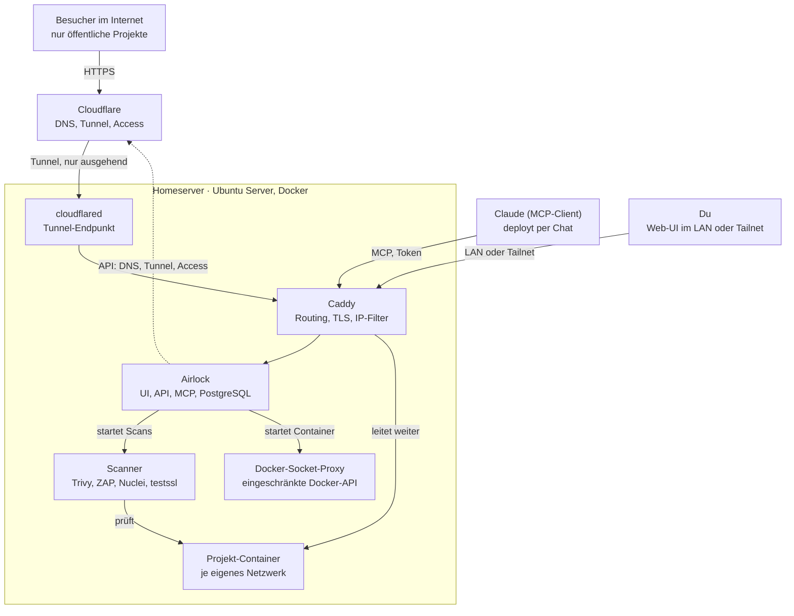

# Airlock – Spezifikation

Stand: 6. November 2026

Airlock bringt ein Projekt mit einem Befehl auf den Homeserver und macht es wahlweise öffentlich über Cloudflare Tunnel, im Heimnetz oder im Tailnet erreichbar. Jedes Deployment wird automatisch auf Sicherheit geprüft, und alles lässt sich per Web-UI oder MCP steuern.

## Ziel und Umfang

Ziel: Ein Projekt soll in unter 5 Minuten von der Idee im Chat oder vom Git-Repo zur erreichbaren URL kommen, ohne Router-Konfiguration und ohne Handarbeit an DNS oder Zertifikaten. Airlock ist ein Werkzeug für eine Person (Joël) und einen Homeserver.

**Im Umfang**

- Deployen aus fünf Quellen: direkt aus dem Chat per MCP (ohne Repo), Git-Repo mit Dockerfile, Docker Compose, statische Seiten, fertige Images aus einer Registry
- Pro Projekt wählbar, wo es erreichbar ist: öffentlich über Cloudflare Tunnel, im Heimnetz (LAN), im Tailnet, oder eine Kombination
- Domains und DNS-Einträge über die Cloudflare-API anlegen und entfernen
- Automatische Security-Prüfung nach jedem Deployment, mit Score und Befunden, sowie Erkennung von Angriffsversuchen und Einbruchsindizien
- Befunde direkt beheben: Security-Header per Klick, Codeänderungen mit Claude (Diff oder Pull Request)
- Steuerung über Web-UI und über einen MCP-Server, damit Claude Projekte hochfahren und prüfen kann
- Logs, Status, Redeploy, Rollback auf die vorherige Version

**Bewusst nicht im Umfang**

- Mehrere Server oder Cluster (kein Kubernetes)
- Mehrere Benutzer und Rollen
- Datenbanken als Managed Service (eine Datenbank läuft als normaler Container im Compose-Projekt)
- Aktive Angriffe auf fremde Systeme: Der Scanner prüft ausschliesslich Projekte, die Airlock selbst verwaltet, und externe Domains mit Besitznachweis

## Architektur

Am Router ist kein Port offen: Öffentlicher Verkehr kommt über den ausgehenden Cloudflare Tunnel, alles andere über LAN oder Tailnet zu Caddy. Airlock selbst ist nur intern erreichbar und steuert Cloudflare (DNS, Tunnel, Access) über deren API.

## Funktionen

### Deploy-Quellen

| Quelle | Eingabe | Was Airlock tut |
| --- | --- | --- |
| **Direkt aus dem Chat (MCP)** | Dateien, die Claude im Gespräch schreibt (Pfad und Inhalt), kein Repo nötig | Dateien in ein lokales Git-Repo auf dem Server schreiben, Typ erkennen, deployen |
| Git-Repo mit Dockerfile | Repo-URL, Branch oder Tag, Port im Container | Klonen, `docker build`, Container starten |
| Docker Compose | Repo-URL oder hochgeladene `compose.yaml`, Name des Web-Services und Port | `docker compose up -d` mit eigenem Projektnamen |
| Statische Seite | Repo-URL oder ZIP, optional Build-Befehl (z.B. `npm run build`) und Ausgabeordner | Build in einem Wegwerf-Container, Ausgabe über Caddy ausliefern |
| Fertiges Image | Image-Referenz (z.B. `ghcr.io/user/app:1.2`), Port | `docker pull`, Container starten |

### Direkt aus dem Chat

Du beschreibst im Chat, was du willst («Mach mir eine Seite, die den Solarertrag von heute zeigt, nur intern»). Claude schreibt den Code und übergibt die Dateien per MCP an Airlock. Ein GitHub-Repo brauchst du dafür nicht.

1. Claude ruft `create_project` mit `source.type: files` und den Dateien auf (Pfad und Inhalt, max. 20 MB pro Aufruf).
2. Airlock legt pro Projekt ein lokales Git-Repo auf dem Server an und committet die Dateien. Jede Änderung ist damit eine Version, Rollback funktioniert wie bei jedem anderen Projekt.
3. Airlock erkennt den Typ selbst: `compose.yaml` vorhanden → Compose, `Dockerfile` → Image bauen, sonst `package.json` mit Build-Skript → statischer Build, sonst reine HTML-Dateien → statisch ausliefern.
4. Der normale Deploy-Ablauf mit Healthcheck und Security-Scan folgt.
5. Spätere Änderungen («mach den Titel grösser») schickt Claude mit `update_files` nur als geänderte Dateien. Mit `read_files` holt sich Claude den aktuellen Stand, auch in einem neuen Chat.

Das lokale Repo lässt sich jederzeit mit `export_repo` als ZIP holen oder auf GitHub pushen, wenn aus dem schnellen Experiment ein richtiges Projekt wird.

**Automatischer Ablauf.** Chat-Deploys werden nach 30 Tagen ohne Änderung gestoppt, nicht gelöscht. 3 Tage vorher kommt eine Benachrichtigung. Ein gestopptes Projekt lässt sich mit einem Klick oder per MCP (`start`) wieder starten. Die Frist ist einstellbar, und pro Projekt kann der Ablauf mit «behalten» abgeschaltet werden.

Zu jedem Projekt gehören Umgebungsvariablen und Secrets. Secrets werden verschlüsselt gespeichert und nie in Logs oder MCP-Antworten ausgegeben.

### Deploy-Ablauf

1. Quelle holen (Clone, Pull oder Upload) und die genaue Version festhalten (Commit-Hash oder Image-Digest).
2. Bauen, mit Zeitlimit von 10 Minuten und Ressourcenlimits.
3. Neue Container in einem projekteigenen Docker-Netzwerk starten. Kein Container bekommt einen Port am Host.
4. Healthcheck abwarten (HTTP 2xx/3xx auf `/` oder einem konfigurierten Pfad).
5. Erst dann den Verkehr auf die neue Version umschalten. Schlägt etwas fehl, bleibt die alte Version aktiv.
6. Routen setzen (Caddy, Cloudflare), dann den Security-Scan starten.
7. Ergebnis in UI, Log und MCP-Antwort melden. Die letzten 5 Versionen bleiben für ein Rollback erhalten.

### Erreichbarkeit

Pro Projekt lassen sich die Ziele frei kombinieren. Standard für neue Projekte ist **nur intern**, öffentlich wird ein Projekt nur auf ausdrücklichen Wunsch.

| Ziel | Adresse | Technik |
| --- | --- | --- |
| Öffentlich | `projekt.deinedomain.ch` (frei wählbar) | Cloudflare Tunnel: Airlock setzt per API eine Ingress-Regel und einen proxied CNAME auf den Tunnel. TLS übernimmt Cloudflare. Keine offenen Ports am Router. |
| LAN | `projekt.int.deinedomain.ch` | Lokaler DNS (Router, AdGuard oder Pi-hole) zeigt `*.int.deinedomain.ch` auf die LAN-IP des Servers |
| Tailnet | `projekt.int.deinedomain.ch` (dieselbe Adresse) | Cloudflare-DNS-Eintrag `*.int.deinedomain.ch` (nicht proxied) auf die Tailscale-IP des Servers |

**Tailscale ist die Hauptadresse des Servers;** eine feste LAN-IP gibt es nicht. Neue Projekte sind standardmässig nur im Tailnet erreichbar, «LAN» ist wählbar (für eigene Namen mit lokalem DNS). nip.io-Namen bilden sich aus der Tailscale-IP, sonst aus der LAN-IP. Airlock liest LAN-IP, LAN-Netz und Tailscale-IP beim Start und stündlich vom Host und zieht IP-Filter und Adressen ohne Zutun nach (siehe INSTALL.md).

Damit gilt im Heimnetz und unterwegs dieselbe interne Adresse. Caddy holt dafür ein Wildcard-Zertifikat von Let's Encrypt über die DNS-Challenge bei Cloudflare, also gültiges HTTPS ohne Warnungen. Caddy beantwortet interne Hostnamen nur für Anfragen aus dem LAN-Subnetz und aus dem Tailscale-Bereich `100.64.0.0/10`.

### Cloudflare verbinden

Cloudflare wird vollständig in der Oberfläche eingerichtet (System → «Cloudflare verbinden»), nicht über `.env` oder Compose-Dateien:

1. **Token einfügen.** Ein Link öffnet die Token-Seite bei Cloudflare mit vorausgefüllten Rechten; die Seite listet die nötigen Rechte mit Zweck auf.
2. **Token sofort prüfen:** gültig, aktiv, jedes Recht vorhanden. Fehlende Rechte werden konkret genannt (welches Recht, für welche Zone oder welches Konto). Geprüft wird ohne Seiteneffekt.
3. **Domains wählen:** interne Basisdomain (Präfix + Zone, z.B. `int.deinedomain.ch`) und Standard-Domain für öffentliche Projekte; optional Tailscale-IP, E-Mail für Access und für Let's Encrypt.
4. **Tunnel per API anlegen,** Tunnel-Token holen, `cloudflared` als Container durch Airlock selbst starten und verwalten – in einem eigenen Netz nur mit Caddy, damit der Tunnel nie Airlock erreicht. Die Systemseite warnt vor Ingress-Regeln, die nicht auf Caddy zeigen, zeigt die cloudflared-Version und bietet ein Update per Knopf.
5. **Wildcard-Zertifikat:** erst ACME-Staging, dann Produktion, mit sichtbarem Fortschritt. `https://` in Adressen und die Weiterleitung erst, wenn das echte Zertifikat da ist.

Dazu: Verbindung trennen (erst wenn kein Projekt öffentlich ist) und Token ersetzen. Das Token liegt verschlüsselt in der Datenbank wie die übrigen Secrets; Änderungen nur mit Anmeldung, nicht mit einem API-Token. Caddy bekommt das Token als Datei in einem eigenen Volume; seine Konfiguration und `autosave.json` enthalten nur den Pfad. In `.env` bleibt nur, was zum Starten nötig ist; die alten Variablen (`INTERNAL_BASE_DOMAIN`, `TLS_MODE`, `CLOUDFLARE_*`) gelten weiter als Rückfall, solange in der Oberfläche nichts gesetzt ist.

### Domains

- Cloudflare-Zonen des Kontos auflisten und eine als Standard setzen
- Subdomains pro Projekt anlegen, ändern, entfernen; beim Löschen eines Projekts werden seine DNS-Einträge und Tunnel-Regeln mit entfernt
- Optional pro öffentlichem Projekt Cloudflare Access davorschalten (Login per E-Mail-Code), für Seiten, die nur du sehen sollst

### Benachrichtigungen

Airlock meldet wichtige Ereignisse per Push und E-Mail. Für Push bietet sich ntfy an (self-hosted als eigenes Projekt oder ntfy.sh), für E-Mail ein beliebiger SMTP-Zugang.

| Ereignis | Standard |
| --- | --- |
| Deploy fehlgeschlagen | Push |
| Neuer kritischer Befund | Push und E-Mail |
| Neuer hoher Befund | E-Mail |
| Projekt wurde öffentlich geschaltet (auch per MCP) | Push |
| Besitznachweis einer externen Domain verloren | E-Mail |
| Tunnel oder Zertifikat mit Problem | Push und E-Mail |
| Einbruchsindiz (Drift, unerwarteter Prozess) | Push und E-Mail |
| Gehäufte Angriffsversuche auf ein Projekt | Push |
| Fix-PR geöffnet oder Befund nach Merge bestätigt behoben | Push |
| Wöchentliche Zusammenfassung (Status, Scores, offene Befunde) | E-Mail |

Jedes Ereignis lässt sich pro Kanal ein- und ausschalten. Benachrichtigungen enthalten nie Secrets.

## Security-Scanner

Jedes Deployment wird automatisch in drei Stufen geprüft, und ein Projekt mit kritischen Befunden wird nicht öffentlich geschaltet. Alle Werkzeuge laufen als Container und werden nur bei Bedarf gestartet.

| Stufe | Wann | Werkzeug | Prüft |
| --- | --- | --- | --- |
| 1. Artefakt | Nach dem Build, vor dem Start | Trivy | Bekannte Schwachstellen (CVEs) im Image, Secrets im Code, Fehlkonfiguration in Dockerfile und Compose (z.B. Container als root, privileged) |
| 2. Laufzeit, passiv | Nach dem Healthcheck | OWASP ZAP Baseline, eigener Header-Check | Security-Header (CSP, HSTS, X-Content-Type-Options, Referrer-Policy, frame-ancestors), Cookie-Flags, Informationslecks, gemischte Inhalte |
| 3. Exposition | Nach dem Healthcheck | Nuclei (nur nicht-invasive Templates), testssl.sh | Offen erreichbare Dateien (`.git`, `.env`, Backups), Admin-Panels, Standard-Logins, TLS-Konfiguration |
| Optional: aktiv | Nur auf Knopfdruck | OWASP ZAP Full Scan | Aktive Tests wie XSS und SQL-Injection |

**Regeln für den Scanner**

- Ziele sind ausschliesslich Hostnamen, die Airlock verwaltet, oder externe Domains mit Besitznachweis (siehe unten). Eine beliebige URL lässt sich nicht scannen, weder über UI noch über MCP.
- Aktive Scans laufen nur gegen die interne Adresse, nie über Cloudflare, und nur nach ausdrücklicher Bestätigung.
- Wöchentlicher Rescan aller laufenden Projekte, weil neue CVEs auch alte Images betreffen.
- Jeder Befund hat Schweregrad, Beschreibung, betroffene Stelle und einen Lösungsvorschlag. Befunde lassen sich mit Begründung als akzeptiert markieren.

**Externe Domains (Freigabeliste)**

Eigene Seiten, die nicht über Airlock laufen (z.B. bei einem Hoster), lassen sich scannen, sobald du den Besitz per DNS nachweist:

1. Hostnamen in der UI oder per MCP (`add_external_target`) eintragen, z.B. `shop.deinedomain.ch`.
2. Airlock erzeugt ein zufälliges Token und verlangt einen TXT-Eintrag `_airlock-verify.shop.deinedomain.ch` mit dem Wert `airlock-verify=<token>`. Liegt die Zone im verbundenen Cloudflare-Konto, setzt Airlock den Eintrag auf Wunsch selbst.
3. `verify_external_target` prüft den Eintrag über öffentliche DNS-Resolver. Erst danach ist das Ziel freigegeben.
4. Vor jedem Scan prüft Airlock den Eintrag erneut. Fehlt er, ist die Freigabe aufgehoben.

Für externe Ziele gelten zusätzliche Grenzen: nur Stufe 2 und 3 (Stufe 1 entfällt, es gibt kein Image), höchstens 5 Anfragen pro Sekunde, aktive Scans nur auf Knopfdruck. Vorher die Bedingungen des Hosters prüfen, manche verbieten Angriffs-Scans auch auf eigene Seiten. Gespeichert wird das im Objekt `ExternalTarget` (`id`, `hostname`, `txt_token`, `verified_at`, `last_check_at`).

Das Scan-Intervall ist pro externer Domain einstellbar: aus, täglich, wöchentlich oder monatlich. Standard ist wöchentlich, nur passiv (Stufe 2 und 3).

**Bewertung**

Der Score startet bei 100. Pro offenem Befund werden abgezogen: kritisch 25, hoch 10, mittel 4, niedrig 1 (Minimum 0). Daraus ergibt sich die Note: A ab 90, B ab 75, C ab 50, D darunter.

Schwelle für «öffentlich»: kein offener kritischer Befund. Wer trotzdem veröffentlichen will, muss den Befund mit Begründung akzeptieren; das wird im Audit-Log festgehalten.

## Angriffserkennung

Der Scanner beantwortet, ob ein Angriff klappen *würde*. Die Angriffserkennung beantwortet, ob jemand angreift und ob etwas durchgekommen ist. Sie arbeitet auf drei Ebenen:

| Ebene | Frage | Werkzeug | Was Airlock zeigt |
| --- | --- | --- | --- |
| Versuche, intern und über den Tunnel | Wird ein Projekt gerade angegriffen? | CrowdSec liest die Zugriffs-Logs von Caddy | Angreifer-IP, erkanntes Muster (Port- und Pfad-Scans, Brute-Force auf Logins, bekannte Exploit-Muster), Zeitpunkt, betroffenes Projekt |
| Versuche, öffentlich | Was hat Cloudflare abgefangen? | Cloudflare Security Events über die Analytics-API | Blockierte Anfragen pro Projekt, auslösende Regel, Herkunftsland |
| Erfolg | Ist etwas durchgekommen? | Drift-Prüfung über die Docker-API, optional Falco | Neue oder geänderte Dateien im Container gegenüber dem Image, unerwartete Prozesse (z.B. eine Shell im Web-Container), unerwartete ausgehende Verbindungen |

**Drift-Prüfung.** Airlock vergleicht regelmässig das Dateisystem jedes laufenden Containers mit seinem Image (`docker diff`). Ein Web-Container, in dem plötzlich neue ausführbare Dateien liegen, ist ein starkes Einbruchsindiz. Bekannte, gewollte Änderungen (Upload-Ordner, Cache) lassen sich pro Projekt ausnehmen. Falco überwacht zusätzlich Prozesse und Systemaufrufe in Echtzeit, braucht aber Kernel-Zugriff und mehr Ressourcen; es ist deshalb optional.

**Reaktion.**

- CrowdSec sperrt erkannte Angreifer-IPs automatisch über einen Bouncer in Caddy, standardmässig für 4 Stunden.
- Für öffentliche Projekte kann Airlock gesperrte IPs zusätzlich als Cloudflare-Regel setzen, damit sie gar nicht erst durch den Tunnel kommen.
- Bei Einbruchsindizien (Drift, unerwarteter Prozess) kommt eine kritische Benachrichtigung per Push und E-Mail. Das Projekt lässt sich mit einem Klick oder per MCP in **Quarantäne** setzen: Container stoppen, Routen entfernen, Zustand für die Analyse aufbewahren. Automatische Quarantäne ist einstellbar, standardmässig aus.

**Wichtig für öffentliche Projekte.** Über den Cloudflare Tunnel kommen alle Anfragen von `cloudflared`. Caddy muss deshalb die echte Besucher-IP aus dem Header `CF-Connecting-IP` übernehmen, und zwar nur von `cloudflared`. Sonst sieht CrowdSec nur eine einzige IP und würde im Ernstfall den eigenen Tunnel sperren.

**Ablage.** Neues Objekt `SecurityEvent` (siehe Datenmodell). Zugriffs-Logs von Caddy werden 30 Tage aufbewahrt; sie enthalten IP-Adressen, also Personendaten von Besuchern öffentlicher Projekte.

**Grenze.** Ob ein Angriff erfolgreich war, lässt sich nie lückenlos beweisen. Airlock liefert Indizien und meldet sie früh; die Beurteilung bleibt bei dir.

## Fix-Assistent

Neben jedem Befund bietet Airlock einen Weg an, ihn zu beheben statt nur zu akzeptieren. Welcher Weg angeboten wird, hängt vom Befund und von der Quelle des Projekts ab. Jede Änderung braucht deine Zustimmung, erzeugt eine neue Version und wird durch einen Nachscan bestätigt.

### Header über Caddy setzen

Fehlende Security-Header behebt Airlock ohne Codeänderung: Caddy ergänzt sie in der Antwort des Projekts. Kein Redeploy nötig, ein Neuladen von Caddy genügt.

| Header | Vorgehen |
| --- | --- |
| `X-Content-Type-Options`, `Referrer-Policy`, `frame-ancestors` | Ein Klick, sofort aktiv |
| `Content-Security-Policy` | Zuerst als `Content-Security-Policy-Report-Only`. Airlock sammelt die Verstösse, die Browser melden, und schlägt daraus eine Regel vor. Erst nach Bestätigung wird sie scharf geschaltet. |
| `Strict-Transport-Security` | Nur bei HTTPS und erst, wenn TLS stabil läuft; kurze `max-age` zum Start |

Setzt die App einen Header selbst, gewinnt der Wert der App; Caddy ergänzt nur, was fehlt. Jede Header-Regel lässt sich pro Projekt wieder entfernen.

Der Header-Check prüft dafür künftig über Caddy, also so, wie Besucher die Seite sehen, und nicht mehr direkt am Container.

### Mit Claude lösen

Für Befunde, die eine Codeänderung brauchen (veraltete Pakete, Dockerfile-Fehlkonfiguration, offen erreichbare Dateien), schlägt Claude eine Änderung vor.

| Quelle | Was passiert |
| --- | --- |
| Chat (`files`) | Vorschlag als Diff in Airlock. Nach Bestätigung neue Version im lokalen Repo, Deploy, Nachscan. |
| GitHub- oder GitLab-Repo | Claude erstellt einen Branch `airlock/fix-<befund>`, committet die Änderung und öffnet einen Pull Request bzw. Merge Request mit Befund, Erklärung und Link zum Scan. Nach dem Merge deployt Airlock automatisch und scannt nach. |
| Fertiges Image | Kein Eingriff möglich; Airlock zeigt nur, welche Image-Version das Problem behebt. |

Nie direkt auf den Standard-Branch pushen, immer über einen eigenen Branch. Branch-Schutzregeln des Repos gelten unverändert.

**Zwei Wege zu Claude:**

1. **Über MCP (Standard).** Der Knopf erzeugt einen fertigen Auftrag («Behebe Befund X in Projekt Y») und kopiert ihn. In Claude oder Claude Code holt sich Claude Befund und Dateien über MCP, schlägt die Änderung vor und spielt sie nach Zustimmung ein bzw. öffnet den PR selbst. Kein API-Schlüssel nötig, läuft über das eigene Abo.
2. **Direkt in Airlock (optional).** Mit `ANTHROPIC_API_KEY` in `.env` fragt Airlock Claude selbst und zeigt den Vorschlag als Diff in der Oberfläche. Abrechnung pro Nutzung über die API. Ohne Schlüssel ist dieser Weg ausgeblendet.

An Claude gehen nur der Befund und die betroffenen Dateien, nie Secrets oder Werte aus der Projekt-Env.

### Mit GitHub und GitLab verbinden

- **GitHub:** über eine eigene GitHub App, angelegt per App-Manifest mit wenigen Klicks. Du wählst die Repos, für die sie gilt. Rechte nur «Contents: write» und «Pull requests: write». Airlock holt pro Vorgang ein Installations-Token, das nach einer Stunde abläuft. Der private Schlüssel der App liegt verschlüsselt wie die Projekt-Secrets.
- **GitLab:** über eine OAuth-App (Rechte `api`, `write_repository`) oder ein Projekt-Zugangstoken pro Repo.
- Die Rückleitung nach der Anmeldung läuft über den Browser, Airlock muss dafür nicht öffentlich erreichbar sein.
- Damit werden auch private Repos als Quelle möglich (bisher nur öffentliche).

### Automatisch deployen nach Merge

Pro Projekt einstellbar (`auto_deploy`): Airlock prüft alle 5 Minuten, ob der Deploy-Branch einen neuen Commit hat, und deployt dann neu. Kein Webhook, weil Airlock nie öffentlich erreichbar ist. Ein Befund, der nach dem Nachscan fehlt, wird als behoben markiert; beim Pull Request hinterlässt Airlock einen Kommentar mit dem Ergebnis.

## Umgebungen

Stand: Konzept vom 10. November 2026, noch nicht umgesetzt. Prototyp-Screenshots: `docs/design-cal/umgebungen/`.

Heute kennt Airlock genau eine Konfiguration: eine Basisdomain mit einem Wildcard-Zertifikat, ein Cloudflare-Token, einen Tunnel, eine Vorlage für die Pause-Seite. Umgebungen teilen denselben Server in mehrere Arbeitsbereiche, etwa privat (`jherren.com`) und ein Verein (`beispiel.ch`), ohne zweiten Server und ohne zweite Airlock-Installation. Airlock bleibt ein Werkzeug für eine Person; Umgebungen sind keine Mandanten mit eigenen Benutzern.

**Eine Umgebung besteht aus**

- einer öffentlichen Domain, der **Hauptzone** bei Cloudflare (weitere Zonen sind möglich, siehe Entscheidung 13),
- einem Cloudflare-Token: eigenes oder das einer anderen Umgebung mitbenutzt,
- einer eigenen **internen Basis** `int.<hauptzone>` mit eigenem Wildcard-Zertifikat und Tailnet-Eintrag,
- eigenen **Standards**: Header-Vorlagen, Pause-Seite, Cloudflare Access,
- allem, was darin entsteht: Projekte, externe Ziele, API- und MCP-Tokens, Audit-Einträge.

### Bedienung

- **Umschalter oben links**, rechts neben dem Namen «Airlock»: Kürzel, Name und Domain der aktuellen Umgebung. Ein Klick öffnet die Liste aller Umgebungen mit Domain, Anzahl Projekte und offenen kritischen Befunden (Zahl mit Wort, nie nur Farbe), darunter «Umgebung anlegen …» und «Umgebungen verwalten». Bedienbar wie die übrigen Menüs (Pfeiltasten, Esc, Fokus zurück zum Auslöser).
- **Alles darunter gilt nur für die gewählte Umgebung:** Projekte, Security, Domains, Externe Ziele, Tokens, Audit und «Einstellungen» (der umgebungsbezogene Teil der heutigen Seite System).
- **Server-Teil abgesetzt:** Unter einem Trenner mit der Beschriftung «Server · für alle Umgebungen» steht, was geteilt bleibt: Übersicht, Tunnel, Benachrichtigungen, GitHub. Die Seitenleiste zeigt damit jederzeit, ob eine Einstellung eine oder alle Umgebungen betrifft.
- **Umgebung in der Adresse:** `/u/<umgebung>/projekte`, `/u/<umgebung>/projekte/<id>`. Zwei Tabs können zwei Umgebungen zeigen, ein kopierter Link öffnet immer die richtige. Die zuletzt gewählte Umgebung merkt sich das Konto (wie die Darstellung in `ui_prefs`); alte Adressen ohne Präfix leiten in die Standard-Umgebung.
- **Kennzeichnung:** Jede Umgebung hat ein Kürzel aus zwei Zeichen (z. B. «JH») in einem neutralen Feld. Farbe dient höchstens als Zusatz; Name und Domain stehen immer daneben.
- Gibt es nur eine Umgebung, zeigt der Umschalter trotzdem Name und Domain, damit klar ist, wofür die Seiten gelten.

### Was pro Umgebung gilt und was geteilt bleibt

| Bereich | Pro Umgebung | Geteilt (Server) |
| --- | --- | --- |
| Projekte samt Deployments, Routen, Env und Secrets, Scans, Befunden, Fix-Anfragen, Security-Events, Öffentlich-Anfragen | ✓ (über das Projekt) | |
| Domains (Cloudflare-Zonen); eine Zone gehört genau einer Umgebung | ✓ | |
| Cloudflare-Token | ✓ wählbar: eigenes oder mitbenutzt | |
| Interne Basis, Wildcard-Zertifikat, Tailnet-DNS-Eintrag | ✓ | |
| Header-Vorlagen, Pause-Seite, Access-Standard | ✓ | |
| Externe Ziele | ✓ | |
| API- und MCP-Tokens | ✓ | |
| Audit-Log | ✓ | Server-Ereignisse erscheinen in jeder Umgebung, als «Server» markiert |
| Server, Docker, Caddy, Scanner, CrowdSec, Socket-Proxy, PostgreSQL | | ✓ |
| Tunnel und `cloudflared` | | ✓ einer pro Cloudflare-Konto (Entscheidung 1) |
| Login, Passwort, Sessions, Darstellung | | ✓ (eine Person) |
| Benachrichtigungskanäle (ntfy, SMTP) | stummschaltbar | ✓ Meldungen nennen die Umgebung |
| GitHub App, GitLab | | ✓ |
| Adresse der Oberfläche und MCP-Endpunkt | | ✓ `airlock.int.jherren.com`, `/mcp`; `deployer.int.jherren.com` leitet weiter |
| Slugs | | ✓ serverweit eindeutig (Entscheidung 3) |

### Datenmodell

Neue Objekte:

| Objekt | Wichtige Felder |
| --- | --- |
| Environment | `id`, `slug`, `name`, `short` (Kürzel), `is_default` (genau eine), `zone_id` (Hauptzone → Domain), `internal_prefix` (Standard `int`), `cloudflare_account_id` (→ CloudflareAccount), `tls_state` (Phase, CA, Schritte, Rate-Limit-Schutz; heute in `app_settings.cloudflare`), `tailnet_record_id`, `pause_page`, `access_default` (neue öffentliche Projekte hinter Access), `access_emails`, `acme_email`, `notify_muted`, `created_at` |
| CloudflareAccount | `id`, `cf_account_id`, `name`, `token_enc`, `token_saved_at`, `last_check`. Ein Token, das eine oder mehrere Umgebungen nutzen. |
| Tunnel | `id`, `cloudflare_account_id`, `cf_tunnel_id`, `name`, `token_enc`, `cloudflared_image`. Höchstens einer pro Cloudflare-Konto. |
| HeaderRuleTemplate | `id`, `environment_id`, `header`, `value`, `mode`. Standard-Header der Umgebung, ohne CSP. |

Geänderte Objekte:

| Objekt | Änderung |
| --- | --- |
| Project | `environment_id` (Pflicht) |
| Domain | `environment_id` (Pflicht); `is_default` entfällt, die Hauptzone steht in `Environment.zone_id` |
| ExternalTarget | `environment_id` (Pflicht) |
| ApiToken | `environment_id` (Pflicht) |
| HeaderRule | `mode` zusätzlich `off`: schaltet einen Vorlagen-Header für dieses Projekt ab |
| AuditEvent | `environment_id`; leer bedeutet Server-Ereignis (Anmeldung, Passwort, Tunnel, Benachrichtigungen, GitHub, Updates) |
| AppSetting | `cloudflare` und `pause_page` wandern in Environment, CloudflareAccount und Tunnel; Passwort, Session, `ui_prefs` (neu mit `last_environment`) und Benachrichtigungen bleiben |

Deployment, Route, Secret, ScanRun, Finding, FixRequest, SecurityEvent, PublicRequest und CspViolation hängen am Projekt und brauchen keine eigene Spalte.

**Durchsetzung.** Jede Abfrage auf Project, Domain, ExternalTarget, ApiToken und AuditEvent geht in der Service-Schicht über einen Pflicht-Scope (`inEnvironment(envId)`); Funktionen ohne Scope gibt es nur für Server-Jobs (wöchentlicher Rescan, Ablauf, Caddy-Abgleich). Tests decken ab, dass ein Projekt aus Umgebung A über ein Token aus B weder lesbar noch änderbar ist.

### Interne Adressen, Zertifikat und DNS

- Jede Umgebung hat eine interne Basis `<präfix>.<hauptzone>`, etwa `int.jherren.com` und `int.beispiel.ch`. Projekte sind intern unter `<slug>.int.<hauptzone>` ihrer Umgebung erreichbar.
- **Zertifikat:** Caddy bekommt pro Basis eine eigene Automatisierungsregel (`subjects: ["*.int.<hauptzone>"]`) mit dem Token der zugehörigen Umgebung für die DNS-Challenge. Jedes Token liegt als eigene Datei im Secrets-Volume (`cloudflare_token_<konto>`); die Caddy-Konfiguration enthält weiterhin nur den Pfad. Staging → Produktion und der Rate-Limit-Schutz laufen pro Umgebung getrennt; ein Fehler in einer Umgebung lässt die Zertifikate der anderen unberührt. Die Basen liegen in verschiedenen registrierten Domains, die Let's-Encrypt-Limits zählen also getrennt.
- **Tailnet:** Airlock setzt in jeder Hauptzone den Eintrag `*.int.<hauptzone>` (A, nicht proxied) auf die Tailscale-IP und zieht ihn bei einem IP-Wechsel in allen Umgebungen nach.
- **LAN:** Der lokale DNS braucht pro Basis eine Umschreibung (`*.int.beispiel.ch` → Server). Die Einstellungen der Umgebung zeigen die Zeile zum Kopieren und prüfen, ob sie greift.
- Der IP-Filter von Caddy (nur LAN und `100.64.0.0/10`) gilt unverändert für alle internen Basen.
- **Oberfläche und MCP** liegen unter `airlock.int.<basis der Standard-Umgebung>`. Die frühere Adresse `deployer.int.<basis>` leitet mit 308 dorthin weiter (Pfad und Query bleiben), damit Lesezeichen und bestehende MCP-Konfigurationen weiter funktionieren; die Weiterleitung gilt wie die Oberfläche nur aus LAN und Tailnet. Die Labels `airlock` und `deployer` sind in allen Basen reserviert (Entscheidung 9).
- nip.io-Adressen (`<slug>.<ip>.nip.io`) bleiben ohne Umgebung; das geht, weil Slugs serverweit eindeutig sind.

### Öffentlich und Cloudflare

- Öffentliche Namen gibt es nur in Zonen der eigenen Umgebung. Neue öffentliche Projekte übernehmen den Access-Standard der Umgebung (an oder aus, erlaubte E-Mail-Adressen).
- **Tunnel:** einer pro Cloudflare-Konto. Umgebungen mit Token im selben Konto teilen sich Tunnel und `cloudflared`-Container; die Ingress-Regeln unterscheiden nach Hostname. Liegt das Token einer Umgebung in einem anderen Konto, bekommt sie einen eigenen Tunnel und einen zweiten `cloudflared`-Container im selben Netz, das nur Caddy erreicht. Grund: Ein proxied CNAME auf `<tunnel>.cfargotunnel.com` funktioniert nach heutigem Stand nur in Zonen desselben Kontos (vor der Umsetzung bei Cloudflare nachprüfen).
- Die Rechteprüfung des Tokens bleibt wie heute, geprüft gegen die Zonen der Umgebung. Ein mitbenutztes Token muss alle Zonen sehen, die ihm zugeordnet sind.
- Cloudflare Security Events (Angriffserkennung) kommen pro Zone und landen damit in der richtigen Umgebung.

### Standards einer Umgebung

- **Header-Vorlagen** für `X-Content-Type-Options`, `Referrer-Policy`, `frame-ancestors` und `Strict-Transport-Security`. Sie gelten für jedes Projekt der Umgebung, solange es für denselben Header keine eigene Regel hat; mit `mode = off` lässt sich ein Vorlagen-Header pro Projekt abschalten. Eine geänderte Vorlage löst einen Caddy-Abgleich für alle Projekte der Umgebung aus und erzeugt einen Audit-Eintrag. CSP bleibt pro Projekt, weil der Report-Only-Ablauf von der App abhängt. Am Befund gibt es zusätzlich «Als Standard der Umgebung übernehmen».
- **Pause-Seite:** Vorlage pro Umgebung (heute global unter System → Veröffentlichung); beim Pausieren pro Projekt anpassbar wie bisher.
- **Access:** Standard für neue öffentliche Projekte und die erlaubten E-Mail-Adressen.
- Beim Anlegen einer Umgebung lassen sich die Standards aus einer bestehenden kopieren; sonst gilt der Airlock-Standard.

### MCP- und API-Tokens

- Jedes Token gehört zu genau einer Umgebung. Erstellt wird es auf der Tokens-Seite der aktuellen Umgebung; die Liste zeigt die Umgebung als Pille mit Namen.
- **Tools sehen und ändern nur diese Umgebung.** `list_projects` und `list_domains` liefern nur deren Einträge. `get_project`, `deploy`, `update_files` und alle anderen Tools antworten bei einem Projekt aus einer anderen Umgebung mit «nicht gefunden», genau wie bei einem unbekannten Projekt; dass es existiert, verrät die Antwort nicht. `create_project` legt in der Umgebung des Tokens an, `subdomain` nur in deren Zonen. `run_scan`, `add_external_target` und `verify_external_target` wirken nur auf externe Ziele dieser Umgebung.
- Die Anweisungen des MCP-Servers nennen die Umgebung («Airlock, Umgebung jherren.com: …»), damit Claude im Chat sagen kann, wo es deployt.
- Es gibt kein Token für alle Umgebungen und kein Tool zum Umschalten. Serverweite Dinge (Tunnel, Passwort, Benachrichtigungen, Umgebungen anlegen) gehen nur in der Oberfläche mit Anmeldung, wie heute schon das Cloudflare-Token.
- MCP-Aufrufe landen im Audit der Umgebung des Tokens.
- Der Endpunkt bleibt `/mcp`; die Umgebung ergibt sich aus dem Token. Bestehende Tokens kommen bei der Migration in die Standard-Umgebung, vorhandene Claude-Konfigurationen funktionieren weiter.
- **REST-API:** `GET/POST /api/v1/environments`, `GET/PATCH/DELETE /environments/{env}`; Listen unter `/environments/{env}/projects`, `/domains`, `/external-targets`, `/tokens`, `/audit`, `/settings`. Einzelobjekte bleiben unter `/projects/{id}` usw.; der Server prüft, dass das Objekt zur Umgebung des Aufrufers passt (Session: alle Umgebungen, API-Token: nur seine).

### Projekt verschieben

Projekt → Einstellungen → «In andere Umgebung verschieben …». Airlock zeigt vor der Bestätigung, was sich ändert:

| Was | Folge |
| --- | --- |
| Interne Adresse | `haushalt.int.jherren.com` wird zu `haushalt.int.beispiel.ch`. Die alte Adresse leitet 30 Tage lang mit 308 weiter (nur aus LAN und Tailnet), danach entfällt sie. Lesezeichen und Integrationen anpassen. |
| Öffentliche Adresse | Die Zone gehört zur alten Umgebung: Route, DNS-Eintrag, Tunnel-Regel und Access-App werden entfernt, das Projekt ist danach privat. Die neue öffentliche Adresse wird in einer Zone der Zielumgebung gewählt, mit der üblichen Schwelle (kein offener kritischer Befund). Eine Pause oder eine vorgemerkte Öffentlich-Anfrage wird verworfen, mit Hinweis. Keine Weiterleitung der alten öffentlichen Adresse. |
| Header | Eigene Regeln des Projekts wandern mit; geerbte Vorlagen wechseln auf die der Zielumgebung. Die Unterschiede stehen in der Vorschau; danach läuft der Header-Check. |
| CSP-Berichte | Der Report-Pfad liegt unter dem neuen Host; gesammelte Verstösse bleiben. |
| Tokens | Tokens der alten Umgebung sehen das Projekt nicht mehr. Ein Chat, der damit gearbeitet hat, braucht das Token der Zielumgebung. |
| Deployments, Versionen, Scans, Befunde, Secrets, lokales Repo, Container | Bleiben, wie sie sind. Kein Neu-Deploy, nur Caddy-Abgleich. Der Slug bleibt. |
| Audit | Eintrag `project.move` in beiden Umgebungen; frühere Einträge bleiben, wo sie entstanden sind. |
| Auto-Deploy, GitHub | Unverändert (geteilt). |

Per MCP lässt sich nicht verschieben, weil ein Token nur eine Umgebung sieht.

### Umgebung anlegen und löschen

**Anlegen** als Assistent wie «Cloudflare verbinden»:

1. Name und Kürzel.
2. Cloudflare: Token einer bestehenden Umgebung mitbenutzen oder ein neues einfügen (Rechteprüfung wie heute).
3. Hauptzone wählen (nur Zonen, die noch keiner Umgebung gehören) und Präfix der internen Basis.
4. Tailnet-Eintrag setzen; Zeile für den lokalen DNS anzeigen.
5. Zertifikat: Staging, dann Produktion, mit sichtbarem Fortschritt.
6. Tunnel: vorhandenen des Kontos nutzen oder neuen anlegen.
7. Standards kopieren von einer bestehenden Umgebung oder Airlock-Standard.

**Löschen** nur, wenn die Umgebung leer ist (keine Projekte, keine externen Ziele). Airlock entfernt Tailnet-Eintrag und Zertifikat, widerruft die Tokens der Umgebung und löscht den Tunnel nur, wenn ihn keine andere Umgebung nutzt. Die Standard-Umgebung lässt sich nicht löschen. Wird eine andere Umgebung zum Standard, wandert die Adresse der Oberfläche mit; Airlock nennt die neue Adresse vor der Bestätigung, und die alte leitet weiter.

### Migration der heutigen Installation

- Eine Migration (nächste freie Nummer nach dem Zusammenführen) legt die neuen Tabellen an und genau eine Umgebung: Name «jherren.com», Slug `jherren`, Kürzel «JH», Standard.
- Ein einmaliger, wiederholbarer Schritt beim Start überträgt `app_settings.cloudflare`: Token → CloudflareAccount, Tunnel → Tunnel, Basis `int.jherren.com` → Präfix `int` und Hauptzone `jherren.com`, TLS-Zustand, Access- und ACME-E-Mail. `pause_page` geht in die Umgebung. Als TypeScript statt SQL, weil die Werte verschlüsselt im JSON liegen. Der alte Eintrag bleibt eine Version lang als Rückfall stehen.
- Alle Projekte, Domains, externen Ziele und Tokens bekommen die Standard-Umgebung; `domains.is_default` wird zur Hauptzone. Audit-Einträge mit Ziel Projekt, Domain, Token oder externes Ziel kommen in die Standard-Umgebung, die übrigen werden Server-Ereignisse.
- **Nach aussen ändert sich nichts:** gleiche Adressen, gleiches Zertifikat (Subject `*.int.jherren.com` bleibt, kein neuer ACME-Auftrag), gleicher Tunnel, MCP-Tokens gelten weiter. Die Standard-Umgebung liest weiter die bestehende Datei `cloudflare_token`; neue Dateien entstehen erst mit einem zweiten Token.
- Die alten `.env`-Variablen (`INTERNAL_BASE_DOMAIN`, `TLS_MODE`, `CLOUDFLARE_*`) gelten nur noch als Rückfall der Standard-Umgebung.
- Oberfläche: `/projekte` leitet auf `/u/jherren/projekte`.

### Offene Entscheidungen

| # | Frage | Optionen | Empfehlung |
| --- | --- | --- | --- |
| 1 | Ein Tunnel für alle oder einer pro Umgebung? | a) einer für alle · b) einer pro Umgebung · c) einer pro Cloudflare-Konto | **c.** Ingress-Regeln nach Hostname trennen die Umgebungen ausreichend; ein zweiter Tunnel im selben Konto brächte nur einen weiteren Container. Ein anderes Konto braucht ohnehin einen eigenen Tunnel. |
| 2 | Trennung in PostgreSQL: eigene Schemas oder Spalte `environment_id`? | a) Schema pro Umgebung · b) Spalte | **b.** Ein Migrationsstrang, echte Fremdschlüssel, Verschieben ist ein `UPDATE`, Drizzle ohne dynamische Schemas, Zähler für den Umschalter mit einer Abfrage. Schutz über den Pflicht-Scope in der Service-Schicht plus Tests; Row-Level-Security lässt sich später ergänzen. |
| 3 | Slugs serverweit oder pro Umgebung eindeutig? | a) serverweit · b) pro Umgebung | **a.** Container, Netze, Images, lokale Repos und nip.io-Namen heissen nach dem Slug; doppelte Slugs bräuchten überall ein Umgebungs-Präfix. |
| 4 | Umgebung in der Adresse oder nur als gespeicherte Auswahl? | a) Pfad `/u/<slug>/…` · b) Auswahl im Konto | **a**, zusätzlich die letzte Wahl merken. Links und mehrere Tabs bleiben eindeutig. |
| 5 | Header-Vorlagen live erben oder beim Anlegen kopieren? | a) live erben · b) kopieren | **a.** Eine Änderung am Standard erreicht alle Projekte; Ausnahmen pro Projekt über eigene Regel oder `off`. CSP nie als Vorlage. |
| 6 | Wo erscheinen Server-Ereignisse im Audit? | a) in jeder Umgebung · b) nur unter Server | **a**, als «Server» markiert und filterbar. Fehlgeschlagene Anmeldungen bleiben wie heute immer sichtbar. |
| 7 | Benachrichtigungskanäle geteilt oder pro Umgebung? | a) geteilt · b) pro Umgebung | **a.** Die Meldung nennt die Umgebung im Titel; pro Umgebung stummschaltbar. Eigene Kanäle erst, wenn eine Umgebung jemand anderem gehört (nicht im Umfang). |
| 8 | Cloudflare-Token pro Umgebung Pflicht oder teilbar? | a) Pflicht · b) teilbar | **b.** Eigenes Token nur, wenn die Zone in einem anderen Konto liegt oder die Rechte bewusst getrennt sein sollen. |
| 9 | Oberfläche nur unter der Standard-Umgebung oder unter jeder Basis? | a) nur Standard · b) jede Basis | **a.** Ein Hostname (`airlock.int.<basis>`, `deployer.int.<basis>` leitet weiter), ein Session-Cookie, keine zusätzlichen Zertifikatsnamen; `airlock` und `deployer` sind in allen Basen reserviert. |
| 10 | MCP: Token pro Umgebung oder ein Token mit Parameter `environment`? | a) pro Umgebung · b) Parameter | **a.** Mit b könnte ein Agent im falschen Bereich deployen, und jede Tool-Beschreibung würde länger. |
| 11 | Externe Ziele pro Umgebung oder geteilt? | a) pro Umgebung · b) geteilt | **a.** Der Besitznachweis hängt an einer Domain, die meist zu einer Umgebung gehört. |
| 12 | GitHub App geteilt oder pro Umgebung? | a) geteilt · b) pro Umgebung | **a.** Eine App mit Installation pro Organisation reicht; pro Umgebung erst, wenn getrennte Konten nötig werden. |
| 13 | Mehrere Zonen pro Umgebung? | a) genau eine · b) Hauptzone plus weitere | **b.** Weitere Zonen desselben Tokens nur für öffentliche Namen; die interne Basis liegt immer in der Hauptzone. |
| 14 | Weiterleitung alter Adressen nach dem Verschieben? | a) keine · b) intern 30 Tage · c) intern und öffentlich | **b.** Öffentlich würde ein DNS-Eintrag in der alten Zone stehen bleiben, der zu keiner Umgebung mehr passt. |

## MCP-Schnittstelle

Airlock bietet einen MCP-Server (Streamable HTTP) unter `https://airlock.int.deinedomain.ch/mcp` (`deployer.int.deinedomain.ch` leitet weiter). Er ist nur aus LAN und Tailnet erreichbar und verlangt ein Bearer-Token pro Client, das sich in der UI erstellen und widerrufen lässt.

| Tool | Parameter | Bestätigung nötig |
| --- | --- | --- |
| `list_projects` | – | Nein |
| `get_project` | `project` | Nein |
| `create_project` | `name`, `source` (Typ `files` mit Dateien, oder Repo, Image, Upload), `port`, `env`, `targets` (`public`, `lan`, `tailnet`), `subdomain` | Ja, wenn `public` dabei ist |
| `update_files` | `project`, geänderte oder gelöschte Dateien, `message`; deployt automatisch neu | Nein |
| `read_files` | `project`, optional `paths` | Nein |
| `export_repo` | `project`, `format` (`zip` oder Push-URL) | Nein |
| `deploy` | `project`, optional `ref` (Branch, Tag, Commit) | Nein |
| `start` / `stop` | `project` | Nein |
| `update_project` | `project`, optional `port`, `healthcheck_path`, `cpu_limit`, `memory_limit_mb`, `deploy` (gleich neu deployen); wirkt sonst beim nächsten Deploy | Nein |
| `rollback` | `project`, optional `version` | Ja |
| `delete_project` | `project` | Ja |
| `get_logs` | `project`, `lines` (max. 500), `since` | Nein |
| `set_targets` | `project`, `targets`, `subdomain`; öffentlich `public_subdomain` + `public_zone` (Zone der Umgebung, Standard Hauptzone) statt vollem Hostnamen, `public_apex` (direkt unter der Zone), `take_over_dns` (fremden DNS-Eintrag ersetzen). Der Name wird normalisiert und vorher geprüft (vergeben, reserviert, fremder DNS-Eintrag), Fehler mit den möglichen Zonen | Ja, wenn `public` dazukommt |
| `list_domains` | – | Nein |
| `add_external_target` | `hostname` | Nein |
| `verify_external_target` | `hostname` | Nein |
| `run_scan` | `project` oder externer `hostname`, `level` (`standard` oder `active`) | Ja bei `active` |
| `get_scan_report` | `project`, optional `scan` | Nein |
| `accept_finding` | `project`, `finding`, `reason` | Ja |
| `list_security_events` | `project`, `since`, `severity` | Nein |
| `quarantine_project` | `project` | Ja |
| `get_fix_context` | `project`, `finding` | Nein |
| `set_security_header` | `project`, `header`, `value`, `mode` (`report-only` oder `enforce`) | Ja bei `enforce` für CSP und HSTS |

**Bestätigungen.** Unterstützt der Client MCP-Elicitation, fragt Airlock direkt dort nach. Sonst antwortet das Tool mit einer Zusammenfassung und einem `confirmation_token`; erst ein zweiter Aufruf mit diesem Token innerhalb von 5 Minuten führt die Aktion aus. So kann ein Agent nichts versehentlich öffentlich machen oder löschen.

**Beispiel.** «Bau mir eine Seite mit dem Solarertrag von heute und stell sie intern bereit.» → Claude schreibt die Dateien → `create_project` mit `source.type: files` und `targets: [lan, tailnet]` → Airlock deployt und scannt → `get_scan_report`. Die Antwort enthält URL, Status, Score und die drei wichtigsten Befunde.

Alle MCP-Aufrufe landen im Audit-Log, mit Client-Name, Tool, Parametern (Secrets maskiert) und Ergebnis.

## Datenmodell und API

Alle Daten liegen in PostgreSQL, als eigener Container im Airlock-Stack; Web-UI, REST-API und MCP-Server nutzen dieselbe Service-Schicht, damit sich alle Wege gleich verhalten.

| Objekt | Wichtige Felder |
| --- | --- |
| Project | `id`, `name`, `slug`, `source_type` (`files`, `dockerfile`, `compose`, `static`, `image`), `local_repo_path`, `source_ref`, `port`, `healthcheck_path`, `status` (`running`, `stopped`, `failed`, `deploying`), `keep` (vom Ablauf ausgenommen), `auto_deploy`, `created_at` |
| Deployment | `id`, `project_id`, `version` (Commit-Hash oder Digest), `started_at`, `finished_at`, `result`, `log_ref`, `is_active` |
| Route | `id`, `project_id`, `target` (`public`, `lan`, `tailnet`), `hostname`, `cf_dns_record_id`, `access_protected` |
| Domain | `id`, `cf_zone_id`, `name`, `is_default` |
| ExternalTarget | `id`, `hostname`, `txt_token`, `verified_at`, `last_check_at`, `scan_interval` |
| Secret | `id`, `project_id`, `key`, `value_encrypted` |
| ScanRun | `id`, `deployment_id` oder `external_target_id`, `level`, `started_at`, `score`, `grade` |
| Finding | `id`, `scan_run_id`, `tool`, `severity`, `title`, `location`, `fix`, `status` (`open`, `accepted`, `fixed`), `accept_reason` |
| HeaderRule | `id`, `project_id`, `header`, `value`, `mode` (`report-only`, `enforce`), `created_at` |
| GitConnection | `id`, `provider` (`github`, `gitlab`), `app_id`, `installation_id`, `repos`, `private_key_encrypted`, `created_at` |
| FixRequest | `id`, `finding_id`, `way` (`mcp`, `api`), `status` (`proposed`, `applied`, `pr_open`, `merged`, `verified`, `rejected`), `branch`, `pr_url`, `diff`, `created_at` |
| SecurityEvent | `id`, `project_id`, `source` (`crowdsec`, `cloudflare`, `drift`, `falco`), `severity`, `kind`, `ip`, `details`, `at`, `status` (`open`, `acknowledged`) |
| ApiToken | `id`, `name`, `token_hash`, `last_used_at`, `revoked_at` |
| AuditEvent | `id`, `at`, `actor` (UI oder Token-Name), `action`, `params_masked`, `result` |

**REST-API** unter `/api/v1` (für die UI und für Skripte):

- `GET/POST /projects`, `GET/PATCH/DELETE /projects/{id}`
- `POST /projects/{id}/deploy`, `/start`, `/stop`, `/rollback`
- `GET /projects/{id}/logs` (auch als Server-Sent Events für Live-Logs)
- `PUT /projects/{id}/routes`
- `POST /projects/{id}/scans`, `GET /scans/{id}`, `PATCH /findings/{id}`
- `GET/POST /external-targets`, `POST /external-targets/{id}/verify`
- `GET /domains`, `GET /audit`

## Sicherheit von Airlock und Betrieb

Airlock selbst ist das wertvollste Ziel auf dem Server, weil es Container starten und DNS ändern kann. Deshalb gelten diese Regeln:

- **Nie öffentlich.** UI, API und MCP laufen nur unter `airlock.int.deinedomain.ch` (früher `deployer.int.deinedomain.ch`, leitet mit 308 weiter), erreichbar aus LAN und Tailnet. Login per Passkey oder Passwort mit Session; MCP nur mit Token.
- **Docker-Socket abschirmen.** Airlock spricht nicht direkt mit `/var/run/docker.sock`, sondern über einen Socket-Proxy, der nur die nötigen API-Bereiche freigibt (Container, Images, Netzwerke, Build).
- **Cloudflare-Token mit minimalen Rechten:** Zone lesen, Zone DNS bearbeiten (nur ausgewählte Zonen), Cloudflare Tunnel bearbeiten, optional Access-Apps bearbeiten. Kein globaler API-Key. Verschlüsselt in der Datenbank, nie in Umgebung, `docker inspect`, Logs oder Caddys Konfiguration.
- **Secrets verschlüsselt.** Der Schlüssel liegt in einer separaten Datei (Rechte 600) und nicht in der Datenbank.
- **Container eingeschränkt.** Keine Host-Ports, kein `privileged`, eigenes Docker-Netzwerk pro Projekt. Caddy und der Scanner werden jeweils nur ins Netzwerk des Projekts gehängt, das sie gerade bedienen.
- **Audit-Log** für jede Änderung, egal ob aus UI, API oder MCP.

### Nicht-funktionale Anforderungen

| Anforderung | Ziel |
| --- | --- |
| Deploy-Zeit, fertiges Image oder statische Seite | unter 2 Minuten bis zur erreichbaren URL |
| Deploy-Zeit, Dockerfile-Build | unter 5 Minuten (abhängig vom Build) |
| Speicherbedarf von Airlock im Leerlauf | unter 300 MB RAM (Server: ThinkPad, 16 GB) |
| Standardlimits pro Projekt | 1 CPU, 512 MB RAM, anpassbar |
| Container-Logs | Rotation fest eingestellt: max. 10 MB pro Datei, 5 Dateien pro Container |
| Neustart des Servers | Alle aktiven Projekte, Caddy und `cloudflared` starten von selbst wieder |
| Backup | PostgreSQL-Dump und Projekt-Volumes nächtlich, 7 Generationen |
| Update von Airlock | Neues Image ziehen, Datenbank-Migrationen laufen automatisch |

Die feste Log-Rotation ist Absicht: Ohne Grössenlimit können Container-Logs eine Festplatte unbemerkt füllen.

## Tech-Stack und Meilensteine

Vorschlag mit Technik, die du aus dem Alltag kennst (TypeScript, React, Vite, Docker); jeder Punkt lässt sich austauschen.

| Bereich | Wahl | Begründung |
| --- | --- | --- |
| Backend | TypeScript, Node 22, Fastify | Ein Stack für API, MCP und Hintergrundjobs |
| Datenbank | PostgreSQL 17 mit Drizzle ORM | Robust, gute Werkzeuge für Backup und Migrationen |
| Docker-Steuerung | dockerode über einen Docker-Socket-Proxy | Programmierbarer Zugriff, eingeschränkte Rechte |
| Lokale Repos | Git auf dem Server (isomorphic-git oder `git`-CLI) | Versionen für Chat-Deploys |
| MCP | Offizielles TypeScript-SDK `@modelcontextprotocol/sdk`, Streamable HTTP | Standard, funktioniert mit Claude |
| Cloudflare | Schlanker eigener Client über `fetch` | DNS, Tunnel anlegen und konfigurieren, Access, Token-Prüfung (siehe MILESTONE-4.md) |
| Reverse Proxy | Caddy mit Modul `caddy-dns/cloudflare` | Konfiguration per Admin-API zur Laufzeit, automatische Zertifikate |
| Tunnel | `cloudflared` als Container, von Airlock gestartet, remote verwaltet | Tunnel und Ingress-Regeln per API, Token als Datei im Container |
| Scanner | Trivy, OWASP ZAP, Nuclei, testssl.sh als Container | Etablierte Open-Source-Werkzeuge, nur bei Bedarf gestartet |
| Angriffserkennung | CrowdSec mit Caddy-Bouncer, Cloudflare Analytics-API, `docker diff`, optional Falco | Etablierte Werkzeuge, CrowdSec läuft als eigener Container |
| Benachrichtigungen | ntfy (Push), SMTP (E-Mail) | Self-hosted möglich, einfache HTTP-API |
| Frontend | React mit Vite | Bekannt aus anderen Projekten |
| Betrieb | Docker Compose auf Ubuntu Server | Airlock, Caddy, `cloudflared`, Socket-Proxy und PostgreSQL als ein Stack |

### Meilensteine

Jeder Meilenstein ist für sich nutzbar.

1. **Lokal deployen:** fertige Images und statische Seiten, Caddy mit LAN-Adressen, einfache Web-UI.
2. **Alle Quellen:** Dockerfile, Compose, Healthcheck, Umschalten ohne Ausfall, Rollback.
3. **MCP und Chat-Deploy:** MCP-Server mit Token, Quelle `files` mit lokalem Git-Repo, Bestätigungen.
4. **Tailnet und Zertifikate:** Wildcard-Zertifikat per DNS-Challenge, interne Adresse im LAN und im Tailnet.
5. **Öffentlich:** Cloudflare Tunnel, DNS-Verwaltung, optional Cloudflare Access.
6. **Security:** drei Scan-Stufen, Score, Schwelle für «öffentlich», externe Domains, wöchentlicher Rescan, Benachrichtigungen.
7. **Angriffserkennung:** CrowdSec mit Caddy-Bouncer, Cloudflare Security Events, Drift-Prüfung, Quarantäne; Falco optional. Setzt Meilenstein 5 (Tunnel) und 6 (Benachrichtigungen) voraus.
8. **Fix-Assistent:** Header über Caddy (CSP mit Report-Only), Header-Check über Caddy, Mit Claude lösen über MCP und optional API, GitHub App und GitLab, private Repos, Auto-Deploy nach Merge.
9. **Umgebungen:** mehrere Arbeitsbereiche auf einem Server, je mit Hauptzone, interner Basis, Zertifikat und Standards; Umschalter in der Oberfläche, Tokens pro Umgebung (siehe Abschnitt Umgebungen).

MCP kommt bewusst früh (Meilenstein 3): Ab dann kann Claude beim Weiterbauen von Airlock selbst schon Testprojekte deployen.

## Offene Fragen

- [ ] Welche Domain(s) sollen verwaltet werden, und liegen sie schon bei Cloudflare?
- [ ] Läuft im Heimnetz bereits ein lokaler DNS (Router, AdGuard, Pi-hole) für die Weiterleitung von `*.int.deinedomain.ch`?
- [ ] ntfy oder anderer Push-Dienst?
- [x] Scan-Intervall pro externer Domain einstellbar (Standard wöchentlich, nur passiv).
- [x] Benachrichtigungen per Push und E-Mail, siehe Abschnitt Benachrichtigungen.
- [x] Chat-Deploys stoppen nach 30 Tagen ohne Änderung, Frist einstellbar.
